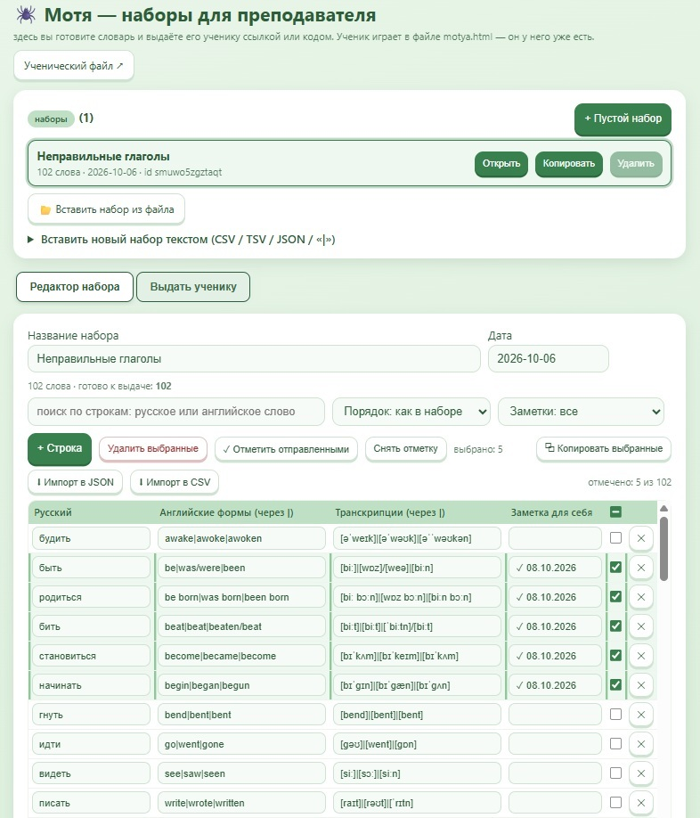
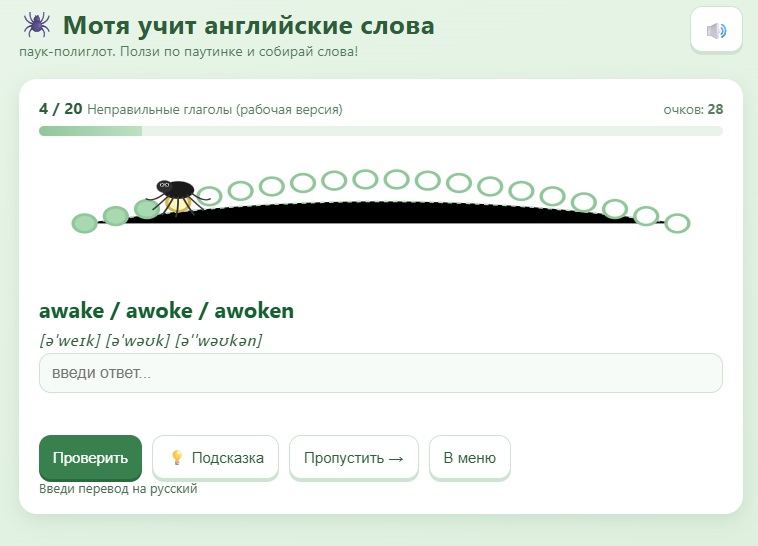
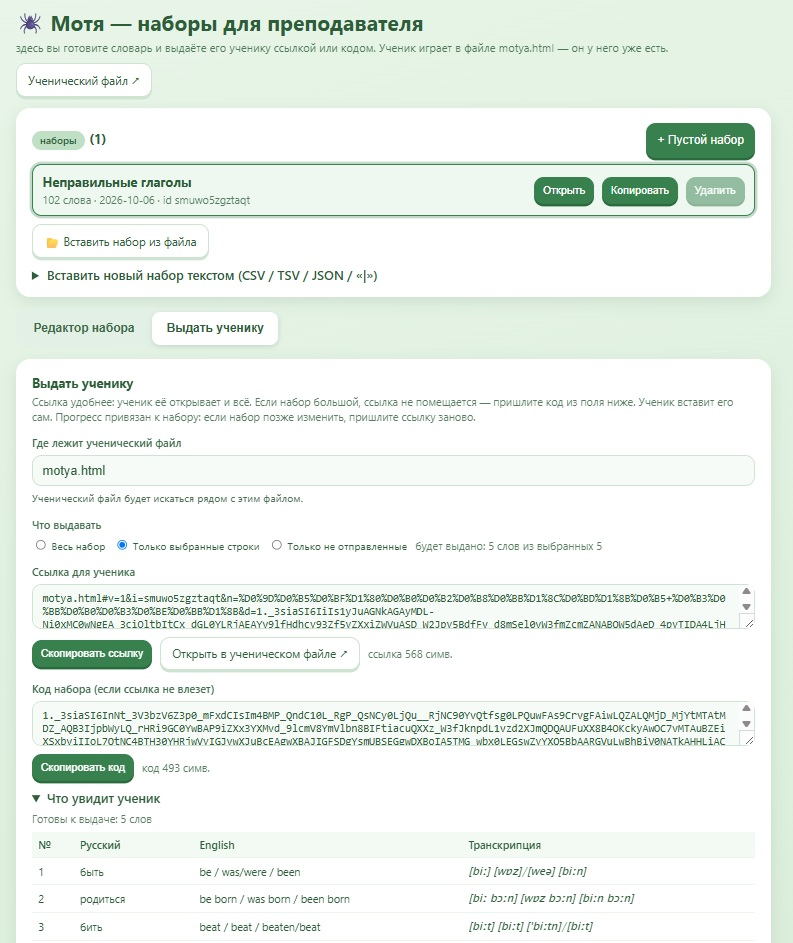
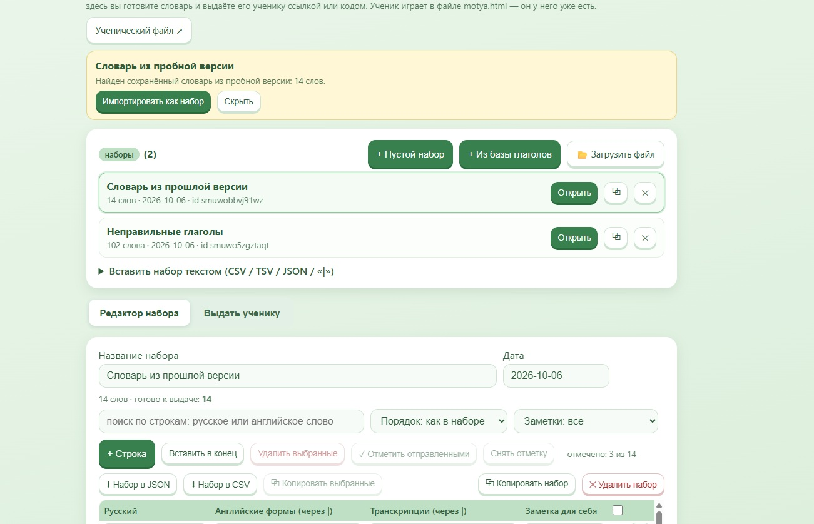

# МОТЯ — тренажёр английских слов

**Оффлайн-приложение для учителя и ученика: преподаватель собирает наборы английских слов и раздаёт их ссылкой, ученик играет и копит прогресс. Без сервера, без регистрации, без интернета.**

[](#-технологии)
[](#-технологии)
[](#-автотесты)
[](#-версии)
[](LICENSE)

---

## Содержание

- [Задача](#-задача)
- [Как это работает](#-как-это-работает)
- [Возможности](#-возможности)
- [Скриншоты](#-скриншоты)
- [Быстрый старт](#-быстрый-старт)
- [Структура проекта](#-структура-проекта)
- [Технологии](#-технологии)
- [Автотесты](#-автотесты)
- [Архитектура и безопасность](#-архитектура-и-безопасность)
- [Известные ограничения](#-известные-ограничения)
- [Документация](#-документация)
- [Версии](#-версии)

---

## Задача

Учитель английского языка должен раздавать классу задания на заучивание слов, а ученики — тренироваться и показывать результаты. Обычные сервисы требуют интернета, регистрации и аккаунтов. **МОТЯ** решает задачу иначе:

- **Ноль инфраструктуры.** Два HTML-файла. Открываются двойным щелчком. Сервер, база данных и учётные записи не нужны.
- **Ноль зависимости.** Всё приложение — инлайн JavaScript и CSS внутри HTML. Никаких `fetch`, CDN и внешних скриптов.
- **Конфиденциальность.** Прогресс живёт только в браузере ученика. Данные никуда не уходят.

**Целевая аудитория:** учителя школ и репетиторы, которые хотят раздавать тренировочные наборы без цифровой инфраструктуры.

---

## Как это работает

### Преподаватель

1. Открывает `motya-teacher.html` — редактор наборов.
2. Создаёт набор: вручную, вставкой из CSV/TSV/JSON/`|`, загрузкой файла или из встроенной базы неправильных глаголов.
3. Нажимает **«Скопировать ссылку»** — получает ссылку вида `motya.html#v=1&i=…`, где набор зашит в URL (base64 + LZSS).
4. Отправляет ссылку (или код набора) ученику: мессенджером, почтой, QR-кодом.

### Ученик

1. Открывает `motya.html` (двойной щелчок — сервер не нужен).
2. Вставляет ссылку или код набора, вводит имя, жмёт **«▶ Играть»**.
3. Играет в один из пяти режимов, видит прогресс «освоено X из Y».
4. По окончании скачивает **CSV-отчёт для учителя**.

```text
┌─────────────────┐     ссылка / код      ┌─────────────────┐
│   УЧИТЕЛЬ       │ ────────────────────▶ │    УЧЕНИК       │
│ motya-teacher   │   (URL-фрагмент)      │   motya.html    │
│   .html         │                       │                 │
│  • редактор     │                       │  • 5 режимов    │
│  • импорт CSV   │                       │  • прогресс     │
│  • пачки слов   │ ◀──────────────────── │  • CSV-отчёт    │
└─────────────────┘    отчёт CSV          └─────────────────┘
        localStorage                           localStorage
     (наборы учителя)                    (прогресс ученика)
```

---

## Возможности

### Редактор преподавателя (`motya-teacher.html`)

- Создание наборов: пустой набор, вставка текстом (CSV / TSV / JSON / `|`), загрузка файла (`.json`, `.csv`, `.txt`, `.tsv`, drag-and-drop).
- Встроенная база неправильных глаголов с транскрипциями.
- Редактирование таблицы: поиск по строкам, сортировка, массовый выбор, удаление строк.
- Защита ID набора при правках — прогресс учеников не теряется.
- Выдача по частям (пачки): отметка отправленных слов, выдача «только выбранные» / «только неотправленные».
- Выгрузка набора в JSON и CSV.
- Мобильная адаптация редактора (проверено на 360×740).

### Игра ученика (`motya.html`)

| Режим | Описание |
|---|---|
| **RU → EN** | Видишь русское слово, вводишь английскую форму |
| **EN → RU** | Видишь английское слово, выбираешь/вводишь перевод |
| **Карточки** | Выбираешь правильный ответ из нескольких вариантов |
| **V1 → V2, V3** | Три формы неправильных глаголов |
| **На время** | Любая из тренировок с таймером |

- Порядок слов: «по порядку» или «в случайном порядке».
- Количество слов в партии: все, 10, 20, 30 или своё число.
- **Паук-полиглот** ползёт по паутине по мере правильных ответов — мотивация для детей.
- Очки, разбор ошибок в конце игры.
- Прогресс хранится по паре «набор + имя ученика».
- Таблица рекордов по устройству.
- CSV-отчёт для учителя (с BOM для Excel, с защитой от CSV-инъекций).
- Короткие звуковые эффекты с выключателем 🔊.

### Работа со словами

- Несколько переводов одного глагола («нести, переносить → bear»): автоматическое объединение строк с одинаковым V1, в игре слово предлагается один раз, в EN→RU принимается любой перевод.
- Транскрипции опциональны.
- Строки с пустым английским словом помечаются красным и не идут в выдачу.

---

## Скриншоты

| Редактор преподавателя | Игра ученика |
|---|---|
|  |  |

| Выдача набора по ссылке | Интерфейс |
|---|---|
|  |  |

---

## Быстрый старт

### Для учителя (без установки)

1. Скачайте репозиторий или файлы `motya.html` и `motya-teacher.html`.
2. Положите оба файла **в одну папку**.
3. Откройте `motya-teacher.html` в браузере (Chrome, Edge, Firefox, Safari).
4. Создайте набор и скопируйте ссылку для учеников.

### Для ученика

1. Откройте `motya.html` (двойной щелчок).
2. Вставьте ссылку или код от учителя, введите имя, нажмите «▶ Играть».

> Подробная инструкция: [docs/user-guide.txt](docs/user-guide.txt) · Памятка ученику: [docs/student-guide.txt](docs/student-guide.txt)

### Для разработчика

```bash
git clone https://github.com/loparenok01-cpu/motya-english-trainer.git
cd motya-english-trainer/tests
npm install   # один раз; нужен Node.js 18+
npm test      # 472 проверки
```

---

## Структура проекта

```text
motya-english-trainer/
├── motya.html                         # Игра ученика (автономный HTML)
├── motya-teacher.html                 # Редактор преподавателя (автономный HTML)
├── irregular_verbs_with_transcription.csv  # Пример словаря (14 глаголов)
├── AUDIT_REPORT.md                    # Отчёт аудита релиз-кандидата
├── LICENSE                            # MIT
├── README.md                          # Этот файл
│
├── docs/
│   ├── user-guide.txt                 # Подробная инструкция для учителя
│   ├── student-guide.txt              # Памятка ученику
│   ├── screenshots/                   # Скриншоты интерфейса
│   └── legacy/                        # Прототип (не поддерживается)
│
└── tests/
    ├── package.json                   # Единственная зависимость: jsdom
    ├── run-all.js                     # Запуск всех наборов
    ├── core-test.js                   # Ядро: упаковка, ссылки, парсер, прогресс
    ├── sync-check.js                  # Сверка CORE + санити-проверки
    ├── motya-page-test.js             # Смоуки страницы ученика (jsdom)
    └── motya-teacher-test.js          # Смоуки редактора (jsdom)
```

**Почему такая структура?**

- Оба HTML-файла лежат в корне: на них ссылаются автотесты и ссылки выдачи (`motya.html#…`).
- `docs/` отделён от релиза: инструкции и скриншоты не мешают работе учителя.
- `legacy/` — исторический прототип, изолирован от релизного кода.

---

## Технологии

| Слой | Решение | Почему |
|---|---|---|
| Разметка и логика | Vanilla HTML + JS (ES2020) | Ноль зависимостей, работает офлайн из файла |
| Сжатие набора в URL | Base64 + LZSS | Набор помещается в ссылку до ~4000 символов; сверх — код набора |
| Хранилище | `localStorage` | Прогресс и наборы живут на устройстве, сервер не нужен |
| Тестирование | Node.js 18+ и jsdom | Смоуки обеих страниц и ядра без реального браузера |
| Безопасность | `escapeHtml`, CSV-экранирование, try/catch | XSS-экраны, CSV-инъекции, отказоустойчивость хранилища |

Приложение не использует фреймворки намеренно: цель — один файл, который учитель может открыть в любое время через 10 лет.

---

## Автотесты

```bash
cd tests
npm install
npm test
```

**472 проверки** в четырёх наборах:

| Набор | Файл | Что проверяет | Кол-во |
|---|---|---|---|
| Ядро | `core-test.js` | Упаковка ссылок, парсер форматов, объединение дублей V1, прогресс | 108 |
| Сверка CORE | `sync-check.js` | Идентичность ядра в обоих HTML, отсутствие `console.*`, речи, чужих ключей | 14 |
| Ученик | `motya-page-test.js` | jsdom-смоуки: приём ссылки, режимы, прогресс, CSV-отчёт, лимит имени, экранирование | 139 |
| Преподаватель | `motya-teacher-test.js` | jsdom-смоуки: редактор, импорт, пачки, выдача, CSV-инъекции, мобильность | 211 |

Ожидаемый итог: `ВСЕ НАБОРЫ ЗЕЛЁНЫЕ`, код выхода 0.

---

## Архитектура и безопасность

- **Нулевой сетевой attack surface.** Ни одного внешнего `script src` / `link href=http`, ни `fetch` / `XMLHttpRequest`. Всё инлайн.
- **Централизованное экранирование.** `escapeHtml` / `esc` во всех HTML-конкатенациях.
- **Защищённый разбор непроверенных данных.** Проверка версии формата `FMT`, `atob` / LZSS / `JSON.parse` в `try/catch`.
- **CSV-инъекции.** Ведущие `=` `+` `-` `@` экранируются префиксом `'` в отчётах обеих сторон.
- **Лимит имени ученика.** 40 символов; список имён ограничен 20 записями.
- **Отказоустойчивость.** Все обращения к `localStorage` в `try/catch`.
- **Доступность.** `aria-live`, `aria-label`, `prefers-reduced-motion`, тач-цели ≥ 60 px.

Полный разбор — в [AUDIT_REPORT.md](AUDIT_REPORT.md).

---

## Известные ограничения

| № | Ограничение | Комментарий |
|---|---|---|
| 1 | Офлайн без сервера и БД | Нет аутентификации ролей; доступ определяется физическим доступом к браузеру |
| 2 | Один браузер — один ученик | Прогресс по свободному имени без PIN; на общем ПК возможен доступ к чужому прогрессу |
| 3 | Прогресс привязан к браузеру | `localStorage` не синхронизируется между устройствами |
| 4 | Данные набора читаемы по ссылке | base64+LZSS — обфускация, не шифрование; не класть в набор персональные данные |
| 5 | Нет озвучки и распознавания речи | Намеренно; есть только короткие звуковые эффекты |

---

## Документация

| Файл | Назначение |
|---|---|
| [docs/user-guide.txt](docs/user-guide.txt) | Полная инструкция для учителя: форматы, пачки, ограничения |
| [docs/student-guide.txt](docs/student-guide.txt) | Памятка ученику (можно раздать классу) |
| [AUDIT_REPORT.md](AUDIT_REPORT.md) | Отчёт аудита: найденные проблемы, правки, финальный чек-лист |

---

## Версии

### v1.0 (текущая)

- Два автономных HTML-файла: ученик и преподаватель.
- Выдача наборов ссылкой или кодом.
- Пять режимов игры, прогресс, таблица рекордов, CSV-отчёт.
- Редактор с импортом/экспортом и выдачей по частям.
- 472 автотеста, аудит безопасности.

---

## Лицензия

Проект распространяется по лицензии [MIT](LICENSE).

---

**Автор:** Olleva · **Версия:** 1.0 · **Стек:** Vanilla HTML/JS, Node.js + jsdom
